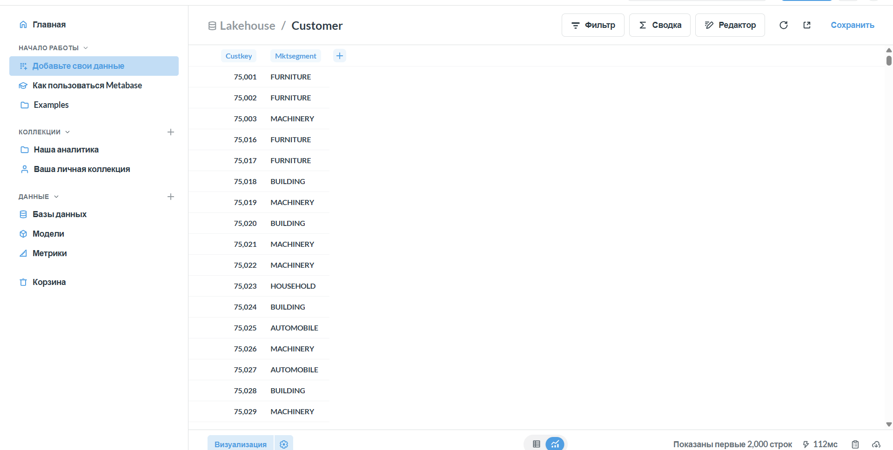
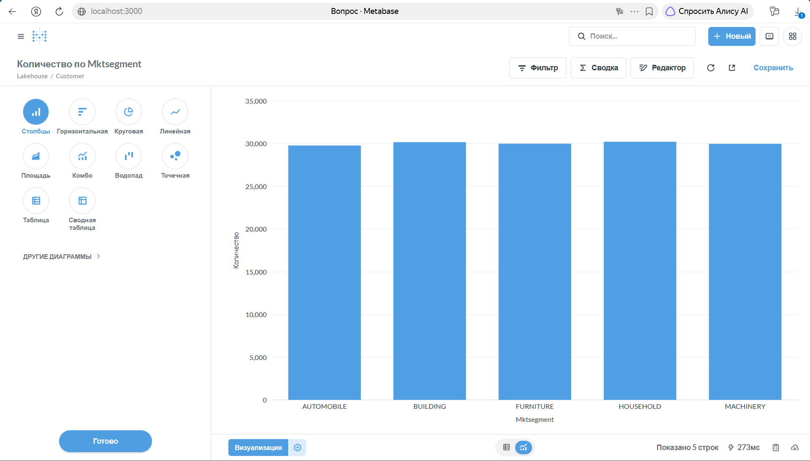

# Отчёт по практической №1


## 1. Вариант и масштаб

| Поле | Значение |
|---|---|
| ФИО (как в VK Education) | Пинякина Виктория Алексеевна |
| Вариант (запрос) | Вариант 1 — Q3 «Shipping Priority» |
| Масштаб `sfN` | sf1 |
| Почему выбрал такой масштаб | Выбрала sf1, чтобы выполнять практическую на своём ноутбуке. Около 6 млн строк в lineitem позволяют сравнить время запроса и размер файлов при разных способах сжатия, сохраняя приемлемое время обработки. |

## 2. Поднятые сервисы — и почему именно они

| Сервис | Роль в стеке | Почему именно он (а не альтернатива) |
|---|---|---|
| MinIO | S3-совместимое объектное хранилище для Parquet-файлов таблиц | Позволяет развернуть объектное хранилище локально в Docker и работать через S3 API без облачного аккаунта и оплаты облачного хранения. |
| PostgreSQL | БД, где Lakekeeper хранит служебные данные каталога | Поддерживается Lakekeeper и обеспечивает надёжное хранение служебных данных. Легко запускается в Docker, а данные сохраняются в отдельном томе. |
| Lakekeeper | Iceberg REST Catalog — управляет каталогом и ссылками на метаданные таблиц | Поддерживает стандартный Iceberg REST API, через который Trino получает доступ к таблицам. Для локальной практической не требуется разворачивать Hive Metastore. |
| Trino | SQL-движок: получает метаданные через Lakekeeper и читает/пишет данные в MinIO | Поддерживает Iceberg, S3 и привычный SQL. Встроенный коннектор TPC-H позволяет генерировать исходные данные без скачивания отдельного набора файлов. |
| Metabase | BI-инструмент: просмотр данных Bronze и график количества клиентов по сегментам | Имеет графический интерфейс и драйвер Starburst (Trino). Позволяет строить графики без программирования; для практической удалось запустить его одним Docker-контейнером. |

### Скрипты, которыми поднимала стек

Сервисы запускала командами Docker из PowerShell. Пароли и ключ шифрования в отчёте заменены обозначениями `<...>`.

```powershell

# MinIO — объектное хранилище файлов таблиц.

# Порт 9000 — S3 API, 9001 — веб-интерфейс.

# Том minio-data сохраняет данные при пересоздании контейнера.

docker run -d --name lakehouse-minio -p 9000:9000 -p 9001:9001 -e MINIO_ROOT_USER=minioadmin -e "MINIO_ROOT_PASSWORD=<MINIO_PASSWORD>" -v minio-data:/data chainguard/minio:latest server /data --console-address ":9001"

# PostgreSQL — служебная БД каталога Lakekeeper.

# Порт 5432 — подключение к БД, pg-data — том для хранения данных.

docker run -d --name lakehouse-pg -e "POSTGRES_PASSWORD=<POSTGRES_PASSWORD>" -p 5432:5432 -v pg-data:/var/lib/postgresql/data postgres:17

# Lakekeeper — Iceberg REST Catalog, API на порту 8181.

# Команда восстановлена по настройкам работающего контейнера.

# Адреса READ и WRITE указывают на запущенный PostgreSQL.

docker run -d --name lakekeeper -p 8181:8181 `
    -e "LAKEKEEPER__PG_ENCRYPTION_KEY=<PG_ENCRYPTION_KEY>" `
    -e "LAKEKEEPER__PG_DATABASE_URL_READ=postgresql://postgres:<POSTGRES_PASSWORD>@host.docker.internal:5432/postgres" `
    -e "LAKEKEEPER__PG_DATABASE_URL_WRITE=postgresql://postgres:<POSTGRES_PASSWORD>@host.docker.internal:5432/postgres" `
    quay.io/lakekeeper/catalog:latest-main serve

# Trino — SQL-движок для чтения и записи таблиц Iceberg.

# В папке catalog находятся настройки подключения к Lakekeeper, MinIO и TPC-H.

docker run -d --name trino -p 8080:8080 -v "D:\lakehouse\catalog:/etc/trino/catalog" trinodb/trino:476

# Metabase — BI-инструмент для просмотра Bronze и построения графиков.

# Порт 3000 — веб-интерфейс, metabase-data — том с настройками Metabase.

docker run -d --name metabase -p 3000:3000 -v metabase-data:/metabase-data -e MB_DB_FILE=/metabase-data/metabase.db metabase/metabase:latest

# Проверка запущенных сервисов.

docker ps

```

После запуска настроила каталог Lakekeeper и warehouse `demo`. В Trino подключила каталоги `lakekeeper` и `tpch`. В Metabase подключилась к Trino через драйвер Starburst (Trino) и построила график количества клиентов по сегментам на данных Bronze.

## 3. Разбор запроса — какие данные нужны

| Таблица TPC-H | Нужные колонки | Что запрос с ними делает (фильтр / джойн / агрегат / вывод) |
|---|---|---|
| customer | custkey, mktsegment | По mktsegment выбирает клиентов сегмента BUILDING. По custkey соединяет клиентов с их заказами в orders. |
| orders | orderkey, custkey, orderdate, shippriority | По custkey соединяет заказы с customer, по orderkey — с lineitem. Отбирает заказы с orderdate раньше 1995-03-15. Использует orderdate и shippriority для группировки и выводит их в результате. |
| lineitem | orderkey, extendedprice, discount, shipdate | По orderkey соединяет позиции с orders. Отбирает позиции с shipdate позже 1995-03-15. Вычисляет выручку позиции как extendedprice * (1 - discount), затем суммирует её по каждому заказу. Выводит orderkey. |

Запрос сортирует заказы по суммарной выручке revenue по убыванию и возвращает первые 10 строк.

## 4. Медальон — решения по каждому слою

В Bronze оставила только колонки, необходимые для Q3, без фильтрации строк. В Silver объединила таблицы и применила фильтры по сегменту клиентов и датам. В Gold сохранила топ-10 заказов по выручке.

Размеры рассчитаны по сумме file_size_in_bytes из метаданных Iceberg `$files` и переведены в МБ делением на 1 000 000.

### Bronze (сырой)

| Таблица | Колонки (что оставила) | Строк | Вес, МБ | Формат | Сжатие | Партиционирование | Обоснование |
|---|---|---|---|---|---|---|---|
| customer | custkey, mktsegment | 150 000 | 0,235272 | PARQUET | GZIP | нет | Parquet подходит для чтения отдельных колонок в аналитических запросах. GZIP использовала для сравнения с ZSTD. Таблица небольшая, поэтому партиционирование не вводила. |
| orders | orderkey, custkey, orderdate, shippriority | 1 500 000 | 6,985443 | PARQUET | GZIP | нет | Оставила колонки для соединений, фильтра по дате и результата Q3. Использовала Parquet и GZIP. При выбранном объёме запрос выполняется за несколько секунд, поэтому начала с хранения без партиций. |
| lineitem | orderkey, extendedprice, discount, shipdate | 6 001 215 | 40,495185 | PARQUET | GZIP | нет | Сохранила колонки для соединения, фильтра по дате отгрузки и расчёта выручки. Parquet позволяет хранить их по колонкам. Отказ от партиций упрощает первоначальное сравнение кодеков. |
| customer_zstd | custkey, mktsegment | 150 000 | 0,239550 | PARQUET | ZSTD | нет | Создала второй набор тех же данных с ZSTD для сравнения с GZIP. Колонки и партиционирование сохранила одинаковыми. |
| orders_zstd | orderkey, custkey, orderdate, shippriority | 1 500 000 | 6,984448 | PARQUET | ZSTD | нет | Использовала те же данные и формат, изменив кодек записи на ZSTD, чтобы сравнить размер файлов и время Q3. |
| lineitem_zstd | orderkey, extendedprice, discount, shipdate | 6 001 215 | 40,474818 | PARQUET | ZSTD | нет | Второй набор самой большой таблицы нужен для сравнения сжатия. Структура и фильтры запроса совпадают с вариантом GZIP. |

### Silver (очищенный)

| Таблица | Колонки (что оставила) | Строк | Вес, МБ | Формат | Сжатие | Партиционирование | Обоснование |
|---|---|---|---|---|---|---|---|
| order_lines | orderkey, orderdate, shippriority, line_revenue, note | 30 519 | 0,247578 | PARQUET | ZSTD | нет | Сохранила позиции заказов после соединений и фильтров Q3. Выручку каждой позиции рассчитала заранее в line_revenue. Parquet сохраняет совместимость со стеком. Для небольшой таблицы партиционирование не вводила. Колонку note добавила при демонстрации изменения схемы. |

### Gold (витрина)

| Таблица | Колонки | Строк | Вес, МБ | Формат | Сжатие | Партиционирование | Обоснование |
|---|---|---|---|---|---|---|---|
| top_orders | orderkey, revenue, orderdate, shippriority | 10 | 0,000846 | PARQUET | ZSTD | нет | Сохранила готовый топ-10 заказов по суммарной выручке. При чтении витрины не требуется заново соединять исходные таблицы. Использовала Parquet для единого формата хранения; для 10 строк партиционирование не требуется. |

## 5. Тесты производительности

Запрос Q3 выполнила по четыре раза для каждого кодека. В таблице указано среднее время всех четырёх запусков. Размер Bronze — сумма размеров файлов customer, orders и lineitem, переведённая в МБ делением на 1 000 000.

| Сжатие на Bronze | Время запроса | Размер Bronze, МБ | Твой вывод (что лучше и почему) |
|---|---|---|---|
| GZIP | 2,9575 с ≈ 2,96 с | 47,715900 | Размер файлов практически совпал с ZSTD, но среднее время запроса оказалось немного больше. В этих замерах преимущества перед ZSTD не получила. |
| ZSTD | 2,8025 с ≈ 2,80 с | 47,698816 | В этих замерах запрос выполнился в среднем на 5,2% быстрее. Размер файлов меньше всего на 0,036%, поэтому преимущество по объёму несущественное. Для этой практической предпочла ZSTD. |

Время запусков GZIP: 3,12; 2,83; 2,91; 2,97 с.

Время запусков ZSTD: 2,98; 2,70; 2,70; 2,83 с.

Измерения выполнены локально на одном узле Trino. Четыре запуска показывают результат данного эксперимента; небольшая разница во времени также может зависеть от кэширования и нагрузки на ноутбук.

## 6. Часть 2 — осмысление и работа с инструментами

### 6.1. Понять и объяснить

| Вопрос | Твой ответ |
|---|---|
| Зачем нужны большие данные и lakehouse (а не обычная БД/хранилище)? | Большие данные возникают, когда объём, скорость поступления или разнообразие информации затрудняют её обработку обычными средствами. Lakehouse объединяет хранение файлов в объектном хранилище с возможностями таблиц: SQL-запросами, транзакциями, изменением схемы и снапшотами. Хранение и вычисления можно масштабировать отдельно. Для небольших задач обычная БД может быть проще; в практической я изучила lakehouse на учебном наборе данных. |
| Пример schema evolution на Silver: добавил/переименовал колонку — что произошло? | В таблицу silver.order_lines добавила колонку note типа VARCHAR командой ALTER TABLE. Старые данные остались доступны, а новая колонка у существующих строк получила NULL. Пересоздавать таблицу и повторно загружать данные не потребовалось. |
| Пример скрипта восстановления данных из снапшота (time travel) | Сохранила ID исходного снапшота 6737422232604808816. Затем изменила note на 'test' у пяти позиций заказа 295360. Через FOR VERSION AS OF прочитала исходное состояние, после чего выполнила rollback_to_snapshot. Проверка показала, что note снова содержит NULL. Скрипт приведён ниже. |

```sql

-- Добавление колонки: изменение схемы Silver.

ALTER TABLE lakekeeper.silver.order_lines

ADD COLUMN note VARCHAR;

-- Просмотр доступных снапшотов.

SELECT committed_at, snapshot_id, operation

FROM lakekeeper.silver."order_lines$snapshots"

ORDER BY committed_at DESC;

-- Тестовое изменение данных.

UPDATE lakekeeper.silver.order_lines

SET note = 'test'

WHERE orderkey = 295360;

-- Time travel: чтение исходного состояния без изменения текущей таблицы.

SELECT orderkey, line_revenue

FROM lakekeeper.silver.order_lines

FOR VERSION AS OF 6737422232604808816

WHERE orderkey = 295360;

-- Восстановление данных из исходного снапшота в Trino 476.

ALTER TABLE lakekeeper.silver.order_lines

EXECUTE rollback_to_snapshot(6737422232604808816);

-- Проверка: у пяти позиций note снова NULL.

SELECT orderkey, line_revenue, note

FROM lakekeeper.silver.order_lines

WHERE orderkey = 295360;

```

ID снапшота относится к моей таблице. При повторении на новом наборе таблиц необходимо получить его из `$snapshots`. Time travel читает прошлое состояние, а rollback делает его текущим. В эксперименте восстановились данные, при этом добавленная колонка note сохранилась.

### 6.2. Подключить инструмент к lakehouse

| Инструмент | Почему выбрала именно его |
|---|---|
| Metabase (BI) | Для моей задачи достаточно просмотра таблиц и построения графика. Metabase имеет графический интерфейс и встроенный драйвер Starburst (Trino). Его удалось развернуть одним Docker-контейнером и подключить к существующему lakehouse без установки отдельного вычислительного движка. |

#### Скрипт развёртывания

```powershell

# Запуск Metabase. Настройки сохраняются в Docker-томе metabase-data.

docker run -d --name metabase -p 3000:3000 -v metabase-data:/metabase-data -e MB_DB_FILE=/metabase-data/metabase.db metabase/metabase:latest

# Проверка запуска контейнера.

docker ps

# Просмотр логов запуска.

docker logs --tail 60 metabase

```

#### Подключение и действия в интерфейсе

1. Открыла http://localhost:3000 и создала локальную учётную запись.

2. При добавлении источника данных выбрала Starburst (Trino).

3. Указала параметры подключения:

| Параметр | Значение |
|---|---|
| Отображаемое имя | Lakehouse |
| Хост | host.docker.internal |
| Порт | 8080 |
| Catalog | lakekeeper |
| Schema | bronze |
| Username | metabase |
| Password | пустой |
| SSL | выключен |
| SSH-туннель | выключен |

4. Открыла таблицу customer из Bronze. В интерфейсе появились строки с колонками custkey и mktsegment.

5. Нажала «Сводка», выбрала количество строк и группировку по mktsegment.

6. Построила столбчатый график количества клиентов по сегментам: AUTOMOBILE, BUILDING, FURNITURE, HOUSEHOLD и MACHINERY.

7. Сохранила график «Количество клиентов по сегментам — Bronze».

Metabase отправляет запросы в Trino. Trino получает метаданные таблиц через Lakekeeper и читает файлы из MinIO. Таким образом, в BI показаны данные Bronze из lakehouse.

Для подтверждения приложены скриншоты просмотра таблицы customer и графика количества клиентов по сегментам.

Просмотр таблицы customer на Bronze:



Количество клиентов по сегментам:



## 7. Выводы

В этой работе я разобралась, как данные проходят через три слоя: в Bronze хранятся исходные данные, в Silver — отфильтрованные и объединённые, а в Gold — готовый результат для анализа. Для хранения выбрала Parquet, потому что запросу нужны только некоторые колонки таблиц. При сравнении GZIP и ZSTD размер файлов оказался почти одинаковым, но с ZSTD запрос в моих замерах выполнялся немного быстрее. Также я проверила, как добавить колонку без повторной загрузки данных и восстановить таблицу после изменения. Через Metabase получилось посмотреть данные Bronze и построить график без написания отдельной программы.

## Приложение. Конфигурация и SQL-скрипты

Ниже приведены настройки и последовательность SQL для повторения обработки данных. Команды создания таблиц предназначены для нового, пустого набора схем. В уже работающей установке повторно выполнять их не нужно: таблицы существуют.

### 1. Файлы конфигурации Trino

Каталоги подключены через папку `D:\lakehouse\catalog`, смонтированную в контейнер Trino как `/etc/trino/catalog`.

Содержимое `catalog/lakekeeper.properties` (секреты заменены обозначениями):

```
connector.name=iceberg
iceberg.catalog.type=rest
iceberg.rest-catalog.uri=http://host.docker.internal:8181/catalog
iceberg.rest-catalog.warehouse=demo
iceberg.rest-catalog.nested-namespace-enabled=true
iceberg.unique-table-location=true
fs.native-s3.enabled=true
s3.endpoint=http://host.docker.internal:9000
s3.path-style-access=true
s3.region=us-east-1
s3.aws-access-key=<MINIO_USER>
s3.aws-secret-key=<MINIO_PASSWORD>
```

Содержимое `catalog/tpch.properties`:

```
connector.name=tpch
```

Имена файлов определяют имена каталогов в SQL: `lakekeeper` и `tpch`. Значения доступа к MinIO должны соответствовать настройкам хранилища. В моей локальной установке имя пользователя MinIO — `minioadmin`.

### 2. Первичная подготовка Lakekeeper

Для новой установки PostgreSQL перед запуском сервера Lakekeeper требуется подготовка его служебной схемы. Ниже команда миграции с теми же адресами PostgreSQL, что использует работающий контейнер:

```
docker run --rm -e "LAKEKEEPER__PG_ENCRYPTION_KEY=<PG_ENCRYPTION_KEY>" -e "LAKEKEEPER__PG_DATABASE_URL_READ=postgresql://postgres:<POSTGRES_PASSWORD>@host.docker.internal:5432/postgres" -e "LAKEKEEPER__PG_DATABASE_URL_WRITE=postgresql://postgres:<POSTGRES_PASSWORD>@host.docker.internal:5432/postgres" quay.io/lakekeeper/catalog:latest-main migrate
```

Ключ шифрования должен быть одинаковым при миграции и запуске сервера. После миграции запускается контейнер Lakekeeper командой из раздела 2 отчёта.

Первичная настройка использует два файла в папке `D:\lakehouse`. Ниже приведено их содержимое; значения доступа к MinIO заменены обозначениями. В рабочей конфигурации они должны совпадать с учётными данными MinIO.

Содержимое `bootstrap.json`:

```
{
  "accept-terms-of-use": true
}
```

Содержимое `create-warehouse.json`:

```
{
  "warehouse-name": "demo",
  "project-id": "00000000-0000-0000-0000-000000000000",
  "storage-profile": {
    "type": "s3",
    "bucket": "warehouse",
    "key-prefix": "",
    "endpoint": "http://host.docker.internal:9000",
    "region": "us-east-1",
    "path-style-access": true,
    "flavor": "s3-compat",
    "sts-enabled": false
  },
  "storage-credential": {
    "type": "s3",
    "credential-type": "access-key",
    "access-key-id": "<MINIO_USER>",
    "secret-access-key": "<MINIO_PASSWORD>"
  }
}
```

Сначала в MinIO создаётся бакет `warehouse`: в веб-интерфейсе [http://localhost:9001](http://localhost:9001) нужно войти с учётными данными MinIO и создать бакет с этим именем. Затем, после запуска Lakekeeper и завершения миграции, из папки `D:\lakehouse` отправляются запросы инициализации. Следующие команды приведены как последовательность для повторения новой установки:

```
# Однократная инициализация Lakekeeper.
Invoke-RestMethod -Method Post -Uri "http://localhost:8181/management/v1/bootstrap" -ContentType "application/json" -InFile .\bootstrap.json

# Создание warehouse demo с хранением файлов в MinIO.
Invoke-RestMethod -Method Post -Uri "http://localhost:8181/management/v1/warehouse" -ContentType "application/json" -InFile .\create-warehouse.json
```

Bootstrap выполняется один раз для новой установки. В моей конфигурации создан проект по умолчанию с ID `00000000-0000-0000-0000-000000000000`; этот ID указан в запросе создания warehouse. После успешного создания `demo` Trino обращается к нему через свойство `iceberg.rest-catalog.warehouse=demo`. Для уже работающего каталога повторять bootstrap и создание warehouse не нужно.

Документация API: [Bootstrap](https://github.com/lakekeeper/lakekeeper/blob/main/docs/docs/bootstrap.md), [создание warehouse](https://docs.lakekeeper.io/getting-started/).

### 3. Создание схем

Открытие консоли Trino из PowerShell:

```
docker exec -it trino trino
```

Далее команды выполняются в консоли Trino:

```
CREATE SCHEMA IF NOT EXISTS lakekeeper.bronze;
CREATE SCHEMA IF NOT EXISTS lakekeeper.silver;
CREATE SCHEMA IF NOT EXISTS lakekeeper.gold;
```

### 4. Загрузка Bronze с GZIP

Для записи файлов с нужным кодеком задаётся свойство сессии. Все три команды создания таблиц выполняются в той же сессии, что и `SET SESSION`.

```
SET SESSION lakekeeper.compression_codec = 'GZIP';

CREATE TABLE lakekeeper.bronze.customer
WITH (format = 'PARQUET')
AS
SELECT custkey, mktsegment
FROM tpch.sf1.customer;

CREATE TABLE lakekeeper.bronze.orders
WITH (format = 'PARQUET')
AS
SELECT orderkey, custkey, orderdate, shippriority
FROM tpch.sf1.orders;

CREATE TABLE lakekeeper.bronze.lineitem
WITH (format = 'PARQUET')
AS
SELECT orderkey, extendedprice, discount, shipdate
FROM tpch.sf1.lineitem;
```

### 5. Второй набор Bronze с ZSTD

Созданы отдельные таблицы с теми же колонками и исходными данными. Изменение настройки сессии влияет на запись новых файлов, а не пересжимает уже существующие.

```
SET SESSION lakekeeper.compression_codec = 'ZSTD';

CREATE TABLE lakekeeper.bronze.customer_zstd
WITH (format = 'PARQUET')
AS
SELECT custkey, mktsegment
FROM tpch.sf1.customer;

CREATE TABLE lakekeeper.bronze.orders_zstd
WITH (format = 'PARQUET')
AS
SELECT orderkey, custkey, orderdate, shippriority
FROM tpch.sf1.orders;

CREATE TABLE lakekeeper.bronze.lineitem_zstd
WITH (format = 'PARQUET')
AS
SELECT orderkey, extendedprice, discount, shipdate
FROM tpch.sf1.lineitem;
```

Для каждого набора число строк проверяется отдельно:

```
SELECT 'customer' AS table_name, count(*) AS row_count FROM lakekeeper.bronze.customer
UNION ALL
SELECT 'orders', count(*) FROM lakekeeper.bronze.orders
UNION ALL
SELECT 'lineitem', count(*) FROM lakekeeper.bronze.lineitem
UNION ALL
SELECT 'customer_zstd', count(*) FROM lakekeeper.bronze.customer_zstd
UNION ALL
SELECT 'orders_zstd', count(*) FROM lakekeeper.bronze.orders_zstd
UNION ALL
SELECT 'lineitem_zstd', count(*) FROM lakekeeper.bronze.lineitem_zstd;
```

Ожидается по 150 000 строк в таблицах клиентов, 1 500 000 в таблицах заказов и 6 001 215 в таблицах позиций заказов.

### 6. Запрос Q3 для замеров

```
SELECT
    l.orderkey,
    sum(l.extendedprice * (1 - l.discount)) AS revenue,
    o.orderdate,
    o.shippriority
FROM lakekeeper.bronze.customer AS c
JOIN lakekeeper.bronze.orders AS o ON c.custkey = o.custkey
JOIN lakekeeper.bronze.lineitem AS l ON l.orderkey = o.orderkey
WHERE c.mktsegment = 'BUILDING'
    AND o.orderdate < DATE '1995-03-15'
    AND l.shipdate > DATE '1995-03-15'
GROUP BY l.orderkey, o.orderdate, o.shippriority
ORDER BY revenue DESC
LIMIT 10;
```

Для второго набора в этом запросе заменяются три имени: `customer` на `customer_zstd`, `orders` на `orders_zstd`, `lineitem` на `lineitem_zstd`. Остальная логика не меняется. Каждый вариант был выполнен четыре раза.

### 7. SQL преобразования Bronze → Silver → Gold

Ниже воспроизведена логика преобразования, соответствующая структуре существующих таблиц. Silver и Gold были созданы до текущего сравнения кодеков. Сжатие существующих файлов проверила по метаданным Parquet: в обоих слоях используется ZSTD.

```sql
SET SESSION lakekeeper.compression_codec = 'ZSTD';

CREATE TABLE lakekeeper.silver.order_lines
WITH (format = 'PARQUET')
AS
SELECT
    l.orderkey,
    o.orderdate,
    o.shippriority,
    l.extendedprice * (1 - l.discount) AS line_revenue
FROM lakekeeper.bronze.customer AS c
JOIN lakekeeper.bronze.orders AS o ON c.custkey = o.custkey
JOIN lakekeeper.bronze.lineitem AS l ON l.orderkey = o.orderkey
WHERE c.mktsegment = 'BUILDING'
    AND o.orderdate < DATE '1995-03-15'
    AND l.shipdate > DATE '1995-03-15';

CREATE TABLE lakekeeper.gold.top_orders
WITH (format = 'PARQUET')
AS
SELECT
    orderkey,
    sum(line_revenue) AS revenue,
    orderdate,
    shippriority
FROM lakekeeper.silver.order_lines
GROUP BY orderkey, orderdate, shippriority
ORDER BY revenue DESC
LIMIT 10;
```

Колонка `note` добавлялась позже, в эксперименте из раздела 6.1. Её не нужно повторно добавлять в уже существующую таблицу.

Для проверки результата:

```
SELECT count(*) AS row_count FROM lakekeeper.silver.order_lines;
SELECT count(*) AS row_count FROM lakekeeper.gold.top_orders;
SELECT * FROM lakekeeper.gold.top_orders ORDER BY revenue DESC;
```

В моей установке Silver содержит 30 519 строк, Gold — 10. Все 10 строк Gold совпали с результатом Q3 по Bronze. Первый заказ — `2456423`, его выручка — `406181.0111`.

### 8. Получение размеров файлов

```
SELECT 'customer' AS table_name, 'GZIP' AS codec, sum(file_size_in_bytes) AS size_bytes
FROM lakekeeper.bronze."customer$files"
UNION ALL
SELECT 'orders', 'GZIP', sum(file_size_in_bytes)
FROM lakekeeper.bronze."orders$files"
UNION ALL
SELECT 'lineitem', 'GZIP', sum(file_size_in_bytes)
FROM lakekeeper.bronze."lineitem$files"
UNION ALL
SELECT 'customer_zstd', 'ZSTD', sum(file_size_in_bytes)
FROM lakekeeper.bronze."customer_zstd$files"
UNION ALL
SELECT 'orders_zstd', 'ZSTD', sum(file_size_in_bytes)
FROM lakekeeper.bronze."orders_zstd$files"
UNION ALL
SELECT 'lineitem_zstd', 'ZSTD', sum(file_size_in_bytes)
FROM lakekeeper.bronze."lineitem_zstd$files"
UNION ALL
SELECT 'silver.order_lines', 'ZSTD', sum(file_size_in_bytes)
FROM lakekeeper.silver."order_lines$files"
UNION ALL
SELECT 'gold.top_orders', 'ZSTD', sum(file_size_in_bytes)
FROM lakekeeper.gold."top_orders$files";
```

Значения в колонке `codec` здесь заданы как подписи вручную, а не определены по содержимому файлов. $files показывает размеры файлов текущего снапшота. Это размер файлов данных, без служебных метаданных и файлов прошлых снапшотов.

### 9. Расчёты сравнения кодеков

| Показатель                  | Расчёт                            | Результат       |
| --------------------------- | --------------------------------- | --------------- |
| Среднее время GZIP          | (3,12 + 2,83 + 2,91 + 2,97) / 4   | 2,9575 с        |
| Среднее время ZSTD          | (2,98 + 2,70 + 2,70 + 2,83) / 4   | 2,8025 с        |
| Уменьшение среднего времени | (2,9575 − 2,8025) / 2,9575 × 100% | около 5,24%     |
| Общий размер GZIP           | 235 272 + 6 985 443 + 40 495 185  | 47 715 900 байт |
| Общий размер ZSTD           | 239 550 + 6 984 448 + 40 474 818  | 47 698 816 байт |
| Разница размеров            | 47 715 900 − 47 698 816           | 17 084 байта    |
| Уменьшение размера          | 17 084 / 47 715 900 × 100%        | около 0,0358%   |

При исключении первого запуска у обоих кодеков среднее составляет 2,9033 с для GZIP и 2,7433 с для ZSTD. В основной таблице отчёта использованы все четыре запуска по одинаковому правилу. Это небольшое локальное сравнение, а не доказательство универсального преимущества одного кодека.

### 10. Изображения для раздела 6.2

Скриншоты размещаются в папке `images` рядом с README:

| Файл | Содержание |
|---|---|
| `images/bronze-customer.png` | Просмотр таблицы customer в Metabase |
| `images/bronze-chart.png` | График количества клиентов по сегментам |

Ссылки на эти изображения приведены в разделе 6.2.

### 11. Проверка сжатия Silver и Gold

Пути файлов текущего состояния таблиц получила из метаданных Iceberg `$files`:

```sql
SELECT file_path FROM lakekeeper.silver."order_lines$files";
SELECT file_path FROM lakekeeper.gold."top_orders$files";
```

Затем через Python и PyArrow прочитала метаданные этих Parquet-файлов непосредственно из MinIO и проверила кодек всех колонок во всех группах строк.

| Таблица | Формат | Подтверждённое сжатие |
|---|---|---|
| silver.order_lines | PARQUET | ZSTD |
| gold.top_orders | PARQUET | ZSTD |

Результат проверки в консоли:

```text
Silver compression: ZSTD
Gold compression: ZSTD
```

Таким образом, для обоих слоёв подтверждено сжатие ZSTD непосредственно по физическим файлам.

